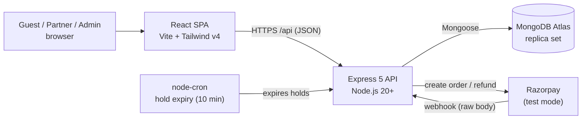

# Architecture

## Request path

1. The SPA calls the Express API with a JWT in the `Authorization` header.
2. Express validates input, then a thin controller delegates to a service.
3. Services own all business rules and use Mongoose models.
4. Multi-document writes (inventory + booking) run in a MongoDB transaction, so
   the target database must be a replica set.

## Payment path

1. The backend creates a Razorpay order for a held booking.
2. The browser completes checkout with Razorpay.
3. Razorpay calls the webhook. The raw request body is preserved for signature
   verification before the JSON parser runs.
4. Payment and booking state changes are idempotent and conditional.

## Background path

`jobs/holdExpiry.js` runs on a schedule. It expires `pending_payment` bookings
whose `holdExpiresAt` has passed and releases their inventory atomically.

## Trust boundaries

- The token proves identity only. Roles and ownership are re-read from the
  database.
- Payment success is trusted only after webhook signature verification.
- The public signup route can only create guests.
