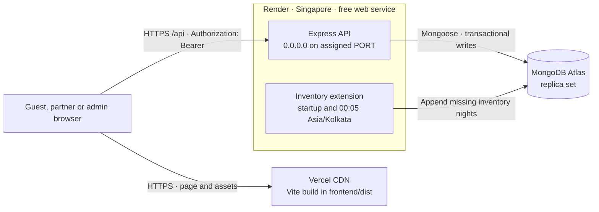

# Architecture

1. Vercel serves the SPA entry point for client-side routes such as `/partner`. Vite embeds the Render API URL when it builds the bundle.
2. The browser contacts Render directly. CORS accepts exact configured frontend origins. Express trusts one proxy hop for client IP rate limiting. Authentication verifies the token and loads the user’s current role from MongoDB.
3. Routes validate input and delegate through thin controllers to services. Inventory changes use conditional writes inside a MongoDB transaction.
4. The API verifies the database topology, initializes indexes and extends inventory before listening. Health checks read Mongoose’s connection state from memory. Render’s shutdown signal lets the API drain requests and close its database connection.

Guest booking, Razorpay order/refund handling, webhook verification and hold expiry are planned. Public signup currently supports guests and partners. Administrators are provisioned through the seed script.
